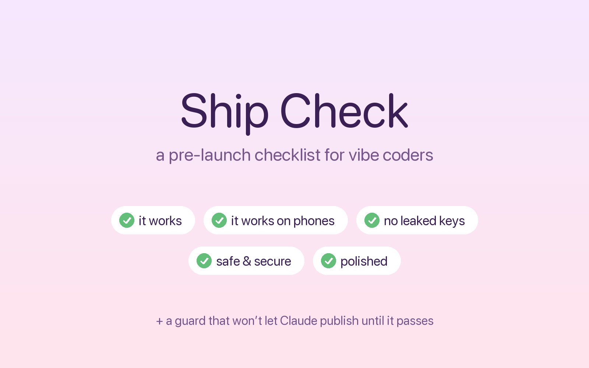
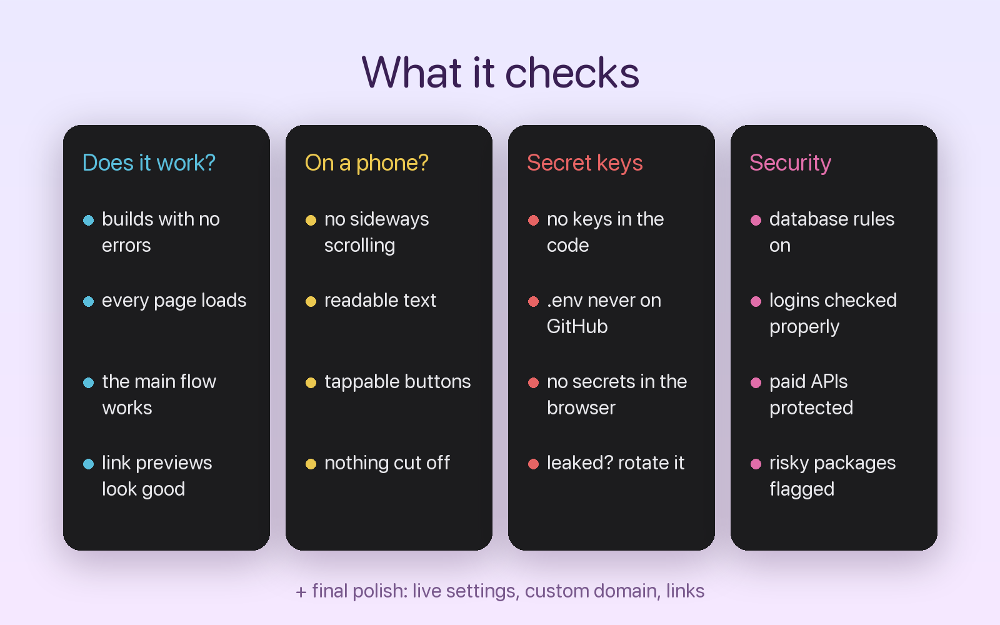
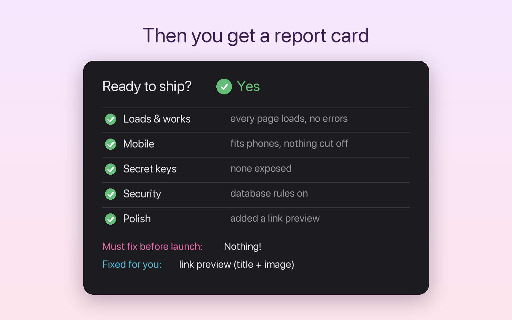
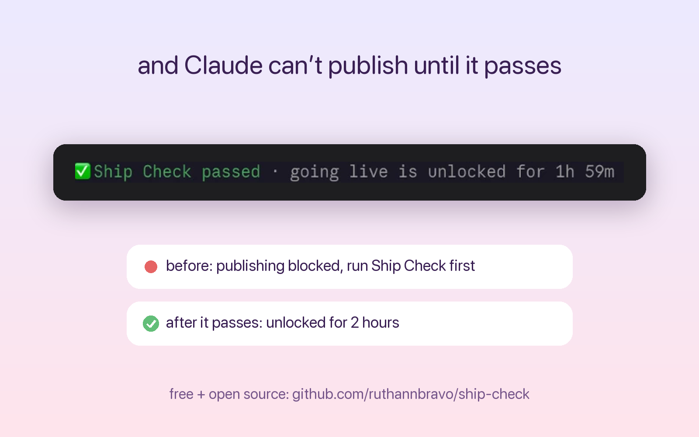

# Ship Check

A pre-launch checklist for [Claude Code](https://claude.com/claude-code), made for vibe coders: people who build with Claude but don't come from an engineering background.

Before your project goes live, say **"ship check"** and Claude runs the checks itself, fixes the small stuff, and gives you a plain-English report card. A built-in guard stops Claude from publishing until it passes.



## What it checks



1. **Does it work?** It builds with no errors, every main page loads with no console errors or broken images, the main thing the app does works start to finish, and the title, favicon and link preview (Open Graph) exist.
2. **Does it work on a phone?** At phone width (375px): no sideways scrolling, readable text, buttons big enough to tap, nothing cut off or overlapping.
3. **Secret keys** (the most important one). No API keys or passwords in the code. `.env` files ignored by git and never committed, including in git history. Only public-safe keys reach the browser. If a real secret ever leaked, it tells you to rotate it, not just delete it.
4. **Core security.** Database access rules (Row Level Security) are on, private pages check logins on the server, paid API routes can't be spammed, user input is validated, risky dependencies are flagged (`npm audit`), and no test pages or debug logs are left behind.
5. **Final polish.** Environment variables are set on the live host, the custom domain works with and without `www`, and links to the project still work.

## The report card



You get ✅ ready, ⚠️ ready with small fixes, or 🛑 not yet. Then you see what must be fixed, what was already fixed for you, and whether you need to do anything.

## The guard



When Claude tries to publish (`vercel --prod`, `vercel promote`, or `git push` to `main`/`master`), the guard blocks it unless Ship Check has passed in the last 2 hours. When Ship Check passes, it writes a `.ship-check-passed` file in the project, and a green line above the prompt shows how long publishing stays unlocked.

Fun fact: the guard blocked its own first upload to GitHub until Ship Check had run on it.

## Install

In Claude Code:

```
/plugin marketplace add ruthannbravo/ship-check
/plugin install ship-check@ship-check
/reload-plugins
```

Then say **"ship check"** before you launch.

## Good to know

- It's Claude following a careful checklist, not a professional security audit. It catches the most common beginner mistakes. For anything handling payments or lots of personal data, get a deeper review too.
- The guard checks that `.ship-check-passed` exists, not how it got there. Think of it as a strong reminder rather than a locked vault.
- Add `.ship-check-passed` to your project's `.gitignore`. Ship Check does this for you.

## License

MIT
